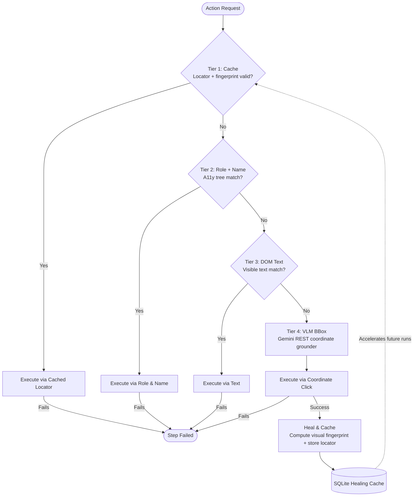

# PixelPilot

PixelPilot is a mutation-resistant browser automation runner for Markdown user stories. It observes a compact semantic page snapshot, tries increasingly expensive grounding tiers, automatically enrolls successful VLM targets into a fingerprinted SQLite healing cache, verifies DOM facts before using vision, and emits traceable HTML evidence.



## Quickstart

Prerequisites are Python 3.11+, `uv`, system Chrome at `/Applications/Google Chrome.app`, and a Gemini API key in `PP_GEMINI_API_KEY`. `PP_VLM_MODEL` defaults to `gemini-3-flash-preview`. PixelPilot never downloads a Playwright browser.

```bash
uv sync
make check
make demo
```

In a second terminal:

```bash
uv run --no-sync pixelpilot doctor
uv run --no-sync pixelpilot run stories/checkout_valid_coupon.md --mutate
uv run --no-sync pixelpilot report <run-id>
uv run --no-sync pixelpilot bench
scripts/record_demo.sh
```

Run artifacts live in `runs/<run-id>/`; only the newest ten run folders are retained. Screenshots are JPEG quality 60 with a longest side of at most 1024 pixels. `make clean` removes run artifacts and Python/tool caches.

The important commands are:

- `make check`: Ruff, strict mypy, and all non-VLM tests.
- `make demo`: local FastAPI shop on port 8000.
- `pixelpilot run STORY [--mutate]`: execute one story in system Chrome.
- `pixelpilot bench`: run three repetitions per story for mutation off and on.
- `pixelpilot report RUN_ID`: regenerate the run’s HTML evidence.
- `pixelpilot doctor`: check system Chrome and make one minimal live Gemini call.

## Planner & Test Fixtures

### Dual-Layer Planner
PixelPilot plans user stories using a two-tier strategy:
1. **`ModelPlanner`**: Uses Gemini in text mode to generate strict JSON plans validated by Pydantic, supporting arbitrary natural language stories with up to 2 retries on schema errors.
2. **`GrammarPlanner`**: Fast, deterministic regex fallback supporting the standard e-commerce flow and test fixtures.

### Edge-Case Test Fixtures
Four dedicated fixtures in `demo_app` test resilience with and without DOM mutation (`?mutate=1`):
- **/scroll**: Target action button placed below a 1400px spacer, testing automatic scroll-into-view.
- **/modal**: Cookie consent modal banner that must be dismissed before the deal button is clickable.
- **/ambiguous**: Three identical "Add" buttons, where only one belongs to the requested "Target Widget".
- **/icons**: Icon-only buttons (🔍, ⭐, 🛒) without text or `aria-label`, exercising visual grounding.

Corresponding story definitions reside in `stories/fixtures/`: `scroll.md`, `modal.md`, `ambiguous.md`, and `icons.md`.

## Measured results

Latest local benchmark, measured with sample size `n=1` run per story per condition:

| Runner | Mutation | Passed | Success |
|---|---:|---:|---:|
| Scripted baseline | 0 | 3/3 | 100.0% |
| Scripted baseline | 1 | 0/3 | 0.0% |
| PixelPilot (accessibility-semantic tiers) | 0 | 3/3 | 100.0% |
| PixelPilot (accessibility-semantic tiers) | 1 | 3/3 | 100.0% |
| PixelPilot VLM-only (pure vision) | 0 | 1/3 | 33.3% |
| PixelPilot VLM-only (pure vision) | 1 | 1/3 | 33.3% |

The baseline uses fixed IDs/classes, so the demo’s mutation deliberately breaks it. Standard PixelPilot resolves these stories through accessible semantics. VLM-only disables cache, role/name, and DOM text so every non-navigation grounding attempt exercises Gemini REST. Measured with sample size n=1 per condition. Pure vision (VLM-only) runs are limited by Gemini free-tier daily quota (20 requests/day per project/model); quota exhaustion (HTTP 429) caused visual grounding failures on coupon stories while the empty-cart story passed without grounding. The full generated record and methodology are in [benchmarks/RESULTS.md](benchmarks/RESULTS.md).

## Design constraints

- A run is capped at 25 steps; each step has a 20-second timeout and two retries.
- Agent code does not contain application selectors. Targets come from healing cache data, accessibility, visible text, or VLM coordinates.
- Gemini REST calls use temperature zero, JSON mode, strict Pydantic validation, 429 backoff, and normalized `[ymin,xmin,ymax,xmax]` coordinates converted to viewport pixels.
- Gemini calls share a process-wide five-requests-per-minute limiter; provider daily quotas can still stop a run.
- Password-field values are never included in snapshots or logs.
- The repository uses Pillow-only average hashing and stays below the 400 MB zero-space ceiling.

## Limitations

- **VLM-only numbers:** the sample size is three runs per story and condition. Provider/project quotas vary; exhausted quota returns HTTP 429 and counts as failure.
- The demo benchmark is a semantic-resilience benchmark, not a measurement of VLM accuracy on arbitrary websites; its successful paths do not need vision.
- Successful VLM actions are automatically enrolled; cache reuse rescans the current target and evicts entries below the fingerprint threshold.
- Spans are written as JSON Lines to `runs/traces.jsonl`; the console emits one compact line per step and the final run result.
- The model planner accepts broader story language through a strict JSON contract, but falls back to a deliberately narrow deterministic grammar when the model is unavailable or invalid.

## Troubleshooting

### Gemini returns HTTP 429

PixelPilot spaces requests at five per minute and retries transient provider errors. A project can still exhaust a shorter-window or daily quota; wait for that quota to reset, reduce VLM-only runs, or use a project/model with sufficient quota. HTTP 429 remains a failed grounding attempt rather than being reported as a pass.

### Port 8000 is already in use

Check the listener with `lsof -nP -iTCP:8000 -sTCP:LISTEN`. Stop the process you own, or launch the demo on another port and pass the matching `--url` value to `pixelpilot run`. The recording script intentionally requires `127.0.0.1:8000`.

### System Chrome is missing

Zero-space mode requires `/Applications/Google Chrome.app`; PixelPilot will not run `playwright install`. Install or move Google Chrome to that path, then run `pixelpilot doctor` to verify Chrome and make the minimal Gemini probe.
