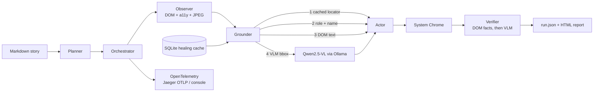

# PixelPilot

PixelPilot is a mutation-resistant browser automation runner for Markdown user stories. It observes a compact semantic page snapshot, tries increasingly expensive grounding tiers, heals known targets from a fingerprinted SQLite cache, verifies DOM facts before using vision, and emits traceable HTML evidence.



## Quickstart

Prerequisites are Python 3.11+, `uv`, system Chrome at `/Applications/Google Chrome.app`, and optionally Ollama with the configured Qwen2.5-VL model. PixelPilot never downloads a Playwright browser.

```bash
uv sync
make check
make demo
```

In a second terminal:

```bash
uv run --no-sync pixelpilot doctor
uv run --no-sync pixelpilot run stories/checkout_valid_coupon.md --mutate
uv run --no-sync pixelpilot report <run-id>
uv run --no-sync pixelpilot bench
```

Run artifacts live in `runs/<run-id>/`; only the newest ten run folders are retained. Screenshots are JPEG quality 60 with a longest side of at most 1024 pixels. `make clean` removes run artifacts and Python/tool caches.

The important commands are:

- `make check`: Ruff, strict mypy, and all non-VLM tests.
- `make demo`: local FastAPI shop on port 8000.
- `pixelpilot run STORY [--mutate]`: execute one story in system Chrome.
- `pixelpilot bench`: run three repetitions per story for mutation off and on.
- `pixelpilot report RUN_ID`: regenerate the run’s HTML evidence.
- `pixelpilot doctor`: check system Chrome and Ollama.

## Measured results

Local benchmark on 2026-11-19, with three runs per story and condition:

| Runner | Mutation | Passed | Success |
|---|---:|---:|---:|
| Scripted baseline | 0 | 9/9 | 100.0% |
| Scripted baseline | 1 | 0/9 | 0.0% |
| PixelPilot | 0 | 9/9 | 100.0% |
| PixelPilot | 1 | 9/9 | 100.0% |

The baseline uses fixed IDs/classes, so the demo’s mutation deliberately breaks it. PixelPilot resolves these stories through accessible semantics. The full generated record and methodology are in [benchmarks/RESULTS.md](benchmarks/RESULTS.md).

## Design constraints

- A run is capped at 25 steps; each step has a 20-second timeout and two retries.
- Agent code does not contain application selectors. Targets come from healing cache data, accessibility, visible text, or VLM coordinates.
- Ollama calls use temperature zero, JSON mode, strict Pydantic validation, and absolute resized-image coordinates.
- Password-field values are never included in snapshots or logs.
- The repository uses Pillow-only average hashing and stays below the 400 MB zero-space ceiling.

## Limitations

- The demo benchmark is a semantic-resilience benchmark, not a measurement of VLM accuracy on arbitrary websites; its successful paths do not need vision.
- Cache persistence and similarity validation are implemented, but cache enrollment is an explicit integration action rather than automatic learning after every successful semantic action.
- OTLP export activates when the OpenTelemetry OTLP gRPC exporter is installed. With the locked dependency set in this repository, tracing falls back to structured console spans.
- The story planner intentionally supports this repository’s concise checkout-story grammar; a general natural-language planner would need a separately validated model contract.
