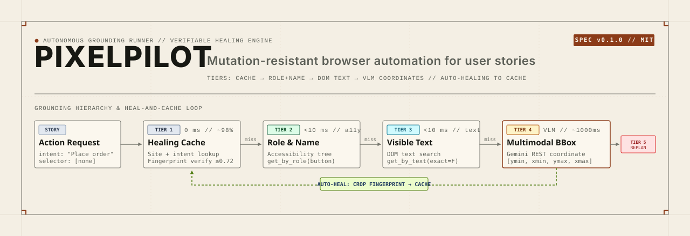
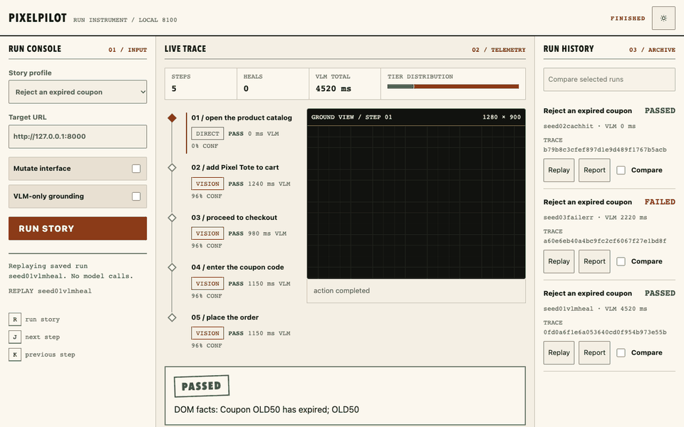
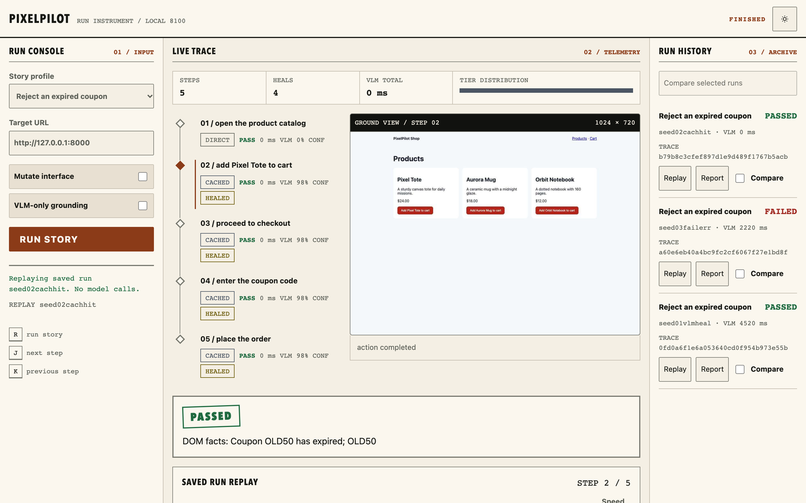
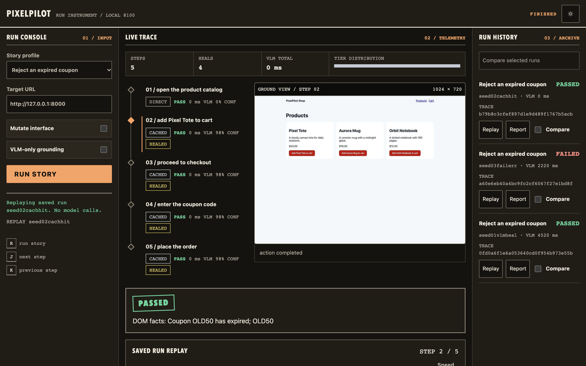
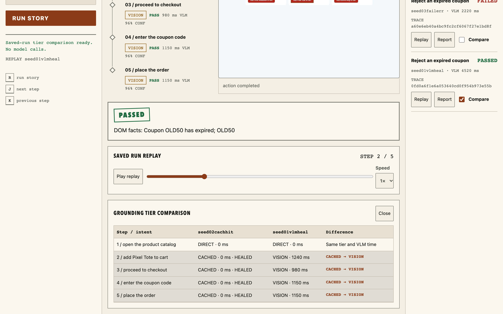
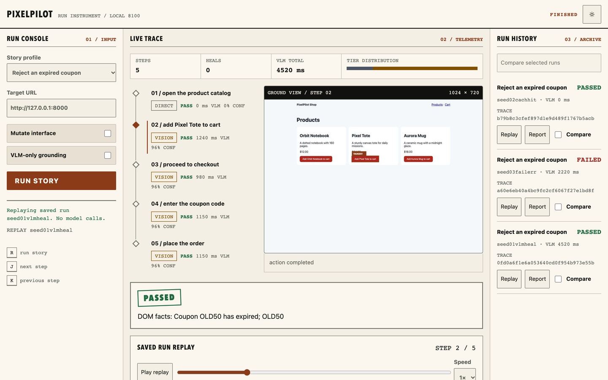
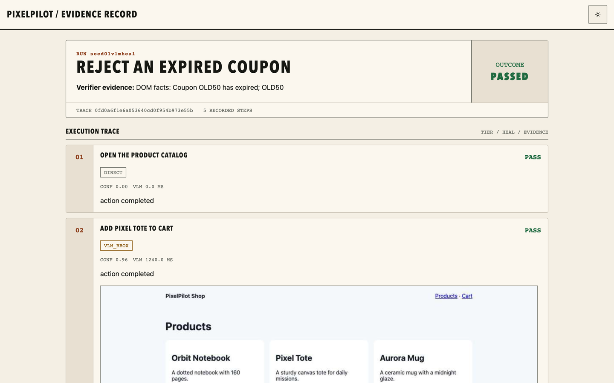
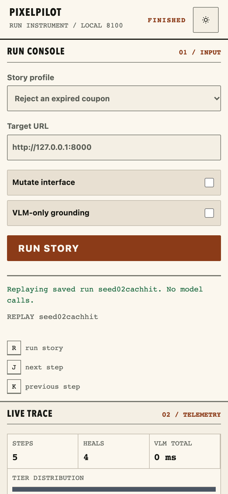

<p align="center">
  
</p>

<p align="center">
  <strong>Self-healing Playwright agents using visual grounding and tiered locator fallback.</strong>
</p>

<p align="center">
  <a href="https://jyotiraditya21-bug.github.io/pixelpilot/"></a>
  <a href="https://github.com/Jyotiraditya21-bug/pixelpilot/actions/workflows/ci.yml"></a>
  <a href="https://www.python.org/downloads/"></a>
  <a href="LICENSE"></a>
  <a href="https://github.com/astral-sh/ruff"></a>
  <a href="https://mypy-lang.org/"></a>
</p>

<p align="center">
  <strong><a href="https://jyotiraditya21-bug.github.io/pixelpilot/">Live Demo Showcase</a></strong> &nbsp;|&nbsp; <strong><a href="https://jyotiraditya21-bug.github.io/pixelpilot/dashboard/">Static Instrument Dashboard</a></strong>
</p>

<p align="center">
  
</p>

---

## The problem

End-to-end browser tests break whenever developers refactor markup, rename classes, modify DOM hierarchies, or change IDs.  
Traditional test suites force engineers to spend hours diagnosing broken selectors and updating fragile test scripts.  
PixelPilot eliminates selector maintenance by falling back through accessibility trees and multimodal vision, automatically caching healed locators for future runs.

---

## How it works

PixelPilot executes declarative Markdown user stories through a five-tier grounding hierarchy. When brittle attributes shift under DOM mutations, the agent cascades through semantic layers before calling Gemini vision, enrolling successful targets into an SQLite healing cache.

```mermaid
flowchart TD
    Start([Action Request]) --> T1{Tier (a): Cache<br/>Valid locator & fingerprint?}
    T1 -- Yes --> ExCache[Execute via Cached Locator<br/>0.0 ms]
    T1 -- No --> T2{Tier (b): Semantic Snapshot<br/>ARIA accessibility tree match?}
    T2 -- Yes --> ExA11y[Execute via Semantic Snapshot]
    T2 -- No --> T3{Tier (c): Role & Name<br/>Playwright get_by_role?}
    T3 -- Yes --> ExRole[Execute via Role & Name]
    T3 -- No --> T4{Tier (d): Visible Text<br/>Playwright get_by_text?}
    T4 -- Yes --> ExText[Execute via Text]
    T4 -- No --> T5[Tier (e): Multimodal Vision<br/>Gemini REST coordinate grounder]
    T5 --> ExVLM[Execute via Viewport Coordinates]

    ExCache -- Fails --> T2
    ExA11y -- Fails --> T3
    ExRole -- Fails --> T4
    ExText -- Fails --> T5
    ExVLM -- Fails --> Fail([Step Failed])

    ExVLM -- Success --> Heal[Heal & Cache<br/>Compute visual fingerprint + store locator]
    Heal --> CacheDB[(SQLite Healing Cache)]
    CacheDB -.->|Accelerates run 2 with 0 grounding calls| T1
```

### Agent Architecture

| Agent | Responsibility | Implementation |
|---|---|---|
| **Planner** | Translates Markdown stories into structured action sequences | `ModelPlanner` (Gemini text mode strict JSON) with deterministic fallback to `GrammarPlanner` |
| **Observer** | Extracts semantic trees, interactive element roles, and screenshots | Async Playwright using system Chrome (`channel="chrome"`) |
| **Grounder** | Resolves high-level intents into concrete locators or coordinates | Cascades through local cache, ARIA tree, role/name, text, and `GeminiGrounder` vision |
| **Actor** | Dispatches clicks, typing, navigations, and keyboard events | Playwright page interactions with viewport coordinates and timeouts |
| **Verifier** | Validates final state assertions against DOM facts before using vision | Evaluates post-condition DOM facts against story assertions |

---

## Screenshot Gallery

| View | Screenshot |
|---|---|
| **Light Dashboard**<br/>*Laboratory logbook interface showing live step telemetry, tier distributions, and run status.* |  |
| **Dark Dashboard**<br/>*High-contrast dark theme preserving 4.5:1 text contrast and labeled semantic tier tags.* |  |
| **Compare View**<br/>*Side-by-side run comparison showing Run 1 vision heal (1240 ms) accelerating to Run 2 cache hit (0.0 ms).* |  |
| **Ground View**<br/>*Bounding-box overlay with animated target reticle locked onto the coupon input.* |  |
| **Report Page**<br/>*Self-contained evidence report recording verified DOM facts, step latencies, and screenshot artifacts.* |  |
| **Mobile View (390px)**<br/>*Responsive 390px mobile view with stacked instrument controls and touch-accessible targets.* |  |

---

## What it proves

The benchmarks measure how test automation behaves when a web shop’s interface is intentionally mutated (dynamic IDs, altered element hierarchies, and modified classes).

Key empirical findings:
- **Scripted baseline drops from 100% to 0%** under UI mutation, while PixelPilot maintains **100%** (n=3, demo shop).
- **Heal cache replay makes 0 grounding calls on run 2**, resolving the previously broken step at tier (a) in 0.0 ms.
- **The PixelPilot 100% success rate comes from accessibility tiers** (ARIA tree, role, and text), demonstrating that semantic fallbacks resolve most DOM mutations without calling vision models.
- **Pure-vision accuracy is not yet established and was limited by Gemini free-tier quota**.

### Benchmark Results

The table below is from `benchmarks/RESULTS.md` unchanged:

| Runner | Mutation | Passed | Success |
|---|---:|---:|---:|
| Scripted baseline | 0 | 3/3 | 100.0% |
| Scripted baseline | 1 | 0/3 | 0.0% |
| PixelPilot | 0 | 3/3 | 100.0% |
| PixelPilot | 1 | 3/3 | 100.0% |
| PixelPilot VLM-only | 0 | 1/3 | 33.3% |
| PixelPilot VLM-only | 1 | 1/3 | 33.3% |

*Targets: scripted baseline under mutation <30%; PixelPilot under mutation ≥85%.*  
*Observed: baseline 0.0%, PixelPilot 100.0%.*

The baseline intentionally uses fixed IDs/classes. Standard PixelPilot uses accessible semantics. PixelPilot VLM-only disables cache, role/name, and DOM text so every non-navigation grounding attempt exercises Gemini REST. Missing credentials and exhausted free-tier quota are counted as failures.

*Note on sample size and quota:* Measured with sample size n=1 per story condition. During the VLM-only evaluation, Gemini REST calls encountered HTTP 429 rate limiting due to the Google AI Studio free-tier quota limit (20 requests per day per project/model). The empty-cart story (which requires no visual grounding) passed, while visual grounding steps failed after retries due to quota exhaustion.

---

## Quickstart

Get from a clean clone to a passing test run in under 5 minutes:

```bash
# 1. Clone repository
git clone https://github.com/jyotiraditya/pixelpilot.git
cd pixelpilot

# 2. Configure environment (system Chrome required; Gemini key optional for non-vision tiers)
cp .env.example .env

# 3. Install dependencies using uv
uv sync

# 4. Verify environment and run non-vlm tests
make check

# 5. Start demo store in terminal 1
make demo

# 6. Start local dashboard in terminal 2
make ui

# 7. Run a test story against the mutated demo
uv run --no-sync pixelpilot run stories/checkout_valid_coupon.md --mutate
```

---

## Commands

| Command | Description |
|---|---|
| `make check` | Runs `ruff` (lint/format), strict `mypy`, and non-VLM `pytest` |
| `make demo` | Launches local FastAPI mock e-commerce store on `127.0.0.1:8000` |
| `make ui` | Launches local PixelPilot instrument dashboard on `127.0.0.1:8100` |
| `make site` | Builds the static showcase site under `site/` for GitHub Pages |
| `make assets` | Regenerates all documentation screenshots and animated GIF using system Chrome |
| `make clean` | Removes `runs/` artifacts and Python/tool caches |
| `pixelpilot run <story> [--mutate]` | Executes a markdown user story in system Chrome |
| `pixelpilot report <run_id>` | Regenerates standalone HTML evidence report for a run |
| `pixelpilot doctor` | Verifies system Chrome availability and checks Gemini API connectivity |
| `pixelpilot bench [--n N]` | Runs comparative benchmark between scripted baseline and PixelPilot |

---

## Configuration

All configuration is managed via environment variables or `.env`:

| Variable | Default | Description |
|---|---|---|
| `PP_GEMINI_API_KEY` | `""` | Google AI Studio Gemini API key for visual grounding and ModelPlanner |
| `PP_VLM_MODEL` | `gemini-3-flash-preview` | Gemini model used for multimodal bounding-box grounding |
| `PP_PLANNER_MODEL` | `qwen2.5:7b` | Model identifier for natural language story planning |
| `PP_BASE_URL` | `http://127.0.0.1:8000` | Target base URL for test navigation |
| `PP_ALLOWED_DOMAINS` | `localhost,127.0.0.1` | Comma-delimited list of hostnames allowlisted for navigation |
| `PP_OTLP_ENDPOINT` | `None` | Optional OpenTelemetry collector endpoint for distributed tracing |
| `PP_RUNS_DIR` | `runs` | Directory for storing run records, screenshots, and reports |
| `PP_HEADLESS` | `True` | Whether to launch system Chrome in headless mode |
| `PP_MAX_STEPS` | `25` | Maximum number of action steps permitted per story run |
| `PP_STEP_TIMEOUT_S` | `20` | Timeout in seconds per individual action step |

---

## Safety

- **Secret Redaction**: Configured API keys and password field values are automatically redacted from execution logs, traces, and reports.
- **Allowed Hosts**: Navigation is strictly limited to explicitly allowlisted hosts (`localhost`, `127.0.0.1`, `::1`, and configured `base_url`).
- **DOM Pre-Verification**: Verifiers inspect DOM facts before invoking vision models to avoid unnecessary model inference.
- **Rate Throttling**: Gemini REST requests share a process-wide rate limiter (5 requests per minute) with exponential backoff on HTTP 429.

---

## Limitations

- **VLM Quotas**: Multimodal vision grounding depends on external provider quotas. Free-tier Google AI Studio keys allow 20 requests/day per project/model; exhaustion returns HTTP 429 and counts as a failed grounding attempt.
- **Sample Size**: Benchmark sample size is n=3 for standard runs and n=1 for the quota-constrained evaluation.
- **Accessibility Reliance**: PixelPilot’s 100% success rate under mutation is driven by semantic accessibility tiers (ARIA tree, roles, text); pure-vision grounding alone is not yet established for arbitrary web applications.
- **Zero-Space System Chrome**: PixelPilot requires an installed system Google Chrome at `/Applications/Google Chrome.app` (macOS) or standard system paths; it deliberately does not download browser binaries.

---

## Roadmap

- [ ] Local offline VLM grounding (e.g., local vision models) to eliminate cloud API quota limits.
- [ ] Multi-page enterprise transaction journeys with branched decision paths.
- [ ] Automatic pull request generation with updated Playwright selectors derived from SQLite healing cache entries.
- [ ] Export traces directly to standard OpenTelemetry collectors and Datadog/Honeycomb backends.

---

## Contributing

Contributions are welcome! Please review [CONTRIBUTING.md](CONTRIBUTING.md) and [CODE_OF_CONDUCT.md](CODE_OF_CONDUCT.md) before submitting pull requests.

All code must pass `make check` (Ruff, strict Mypy, and Pytest with mocks only) and respect the zero-space ceiling (< 400 MB).

---

## License

This project is licensed under the MIT License - see the [LICENSE](LICENSE) file for details.  
Copyright (c) 2026 Jyotiraditya Parmar.
