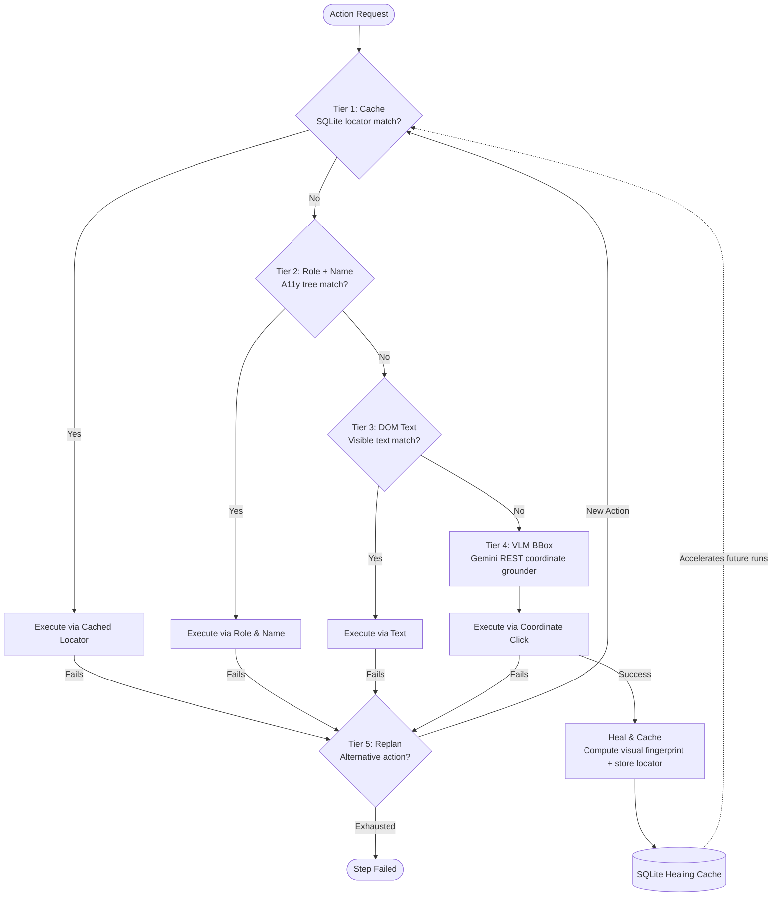

# Architecture

PixelPilot separates browser effects from reasoning. `Planner` converts user stories into typed semantic actions. `Observer` gathers a pruned visible-element snapshot and a bounded JPEG. `Grounder` escalates through five locator tiers from cache to accessibility, text, and Gemini REST visual grounding. `Actor` executes the action with replan fallback. `Verifier` checks concrete DOM facts before requesting visual judgment.

`Orchestrator` owns the safety envelope: 25 steps, 20 seconds per attempt, and two retries. It creates the system-Chrome session, retains the newest ten run directories, writes `run.json`, and appends OpenTelemetry run/step/agent spans to `runs/traces.jsonl`. Reports are deterministic renderings of the JSON record plus sibling screenshots.

The demo mutates generated IDs, CSS classes, product order, flex direction, button placement, and color while retaining accessible language. This isolates selector brittleness from business-flow correctness.

## Locator Tiers and Heal-and-Cache Loop

PixelPilot implements five hierarchical grounding tiers, combining deterministic semantic locators with multimodal visual fallback and perceptual self-healing:

### The 5 Locator Tiers
1. **Tier 1 (Cache)**: Checks SQLite healing cache for previously learned locators matched by site and intent.
2. **Tier 2 (Role + Name)**: Matches accessible roles and names in the DOM snapshot accessibility tree.
3. **Tier 3 (DOM Text)**: Resolves visible button/link/element text.
4. **Tier 4 (VLM BBox Center)**: Calls Gemini REST with the page screenshot to predict normalized bounding boxes `[ymin, xmin, ymax, xmax]`, converted to viewport center coordinates for clicking.
5. **Tier 5 (Replan)**: When action execution fails, actor allows one replan attempt to propose an alternative action before failing the step.

### Heal-and-Cache Loop
When an action succeeds via Tier 4 (VLM), `_enroll_vlm_target` computes a perceptual average hash of the target element crop. The resolved locator is enrolled in `HealingCache`. Subsequent runs retrieve the cached locator in Tier 1, skipping expensive vision calls and achieving instant resilience.

## Planners

PixelPilot uses a dual planning system:
- **`ModelPlanner`**: Strict-JSON model planner using Gemini text completion (`gemini-2.5-flash`). Translates free-form natural language stories into typed Pydantic `Plan` structures with step-by-step `ActionRequest`s. Employs temperature zero, strict JSON schema validation, and up to 2 retries on malformed or schema-invalid responses before falling back.
- **`GrammarPlanner`**: Fast, deterministic regex/keyword pattern matching planner supporting standard shopping workflows and fixture scenarios.
- The default `Planner` automatically initializes `ModelPlanner` when Gemini credentials are configured and delegates to `GrammarPlanner` as a deterministic fallback.

## Test Fixtures

Four fixture pages are hosted in `demo_app` to evaluate edge cases under mutation (`?mutate=1`):
- **/scroll**: The target button ("Confirm bottom action") is placed below a 1400px spacer below the fold, testing automatic scroll-into-view.
- **/modal**: A cookie consent modal dialog overlays the entire viewport; users must accept cookies before the "Claim special deal" button becomes interactable.
- **/ambiguous**: Renders three identical "Add" buttons, only one of which corresponds to the named "Target Widget", testing context-aware element selection.
- **/icons**: Buttons contain only icons (🔍, ⭐, 🛒) with no text or `aria-label`, requiring visual recognition.

Corresponding stories are located in `stories/fixtures/`:
- `stories/fixtures/scroll.md`
- `stories/fixtures/modal.md`
- `stories/fixtures/ambiguous.md`
- `stories/fixtures/icons.md`

## Limitations

- **VLM-Only Quota & Sample Size**: VLM-only evaluation numbers are strictly limited by Google Gemini free-tier daily quotas (20 requests/day per project/model) and the sample size ($n=3$). When quota is exhausted, requests return HTTP 429 and fail after retries.
- **Semantic Prioritization**: In standard mode, PixelPilot prioritizes cache, accessibility semantics, and visible DOM text, reserving visual grounding for elements lacking reliable markup.
- **System Chrome Dependency**: PixelPilot targets system Chrome (`channel="chrome"`) to stay within zero-space budget constraints and avoids downloading bundled browser binaries.
